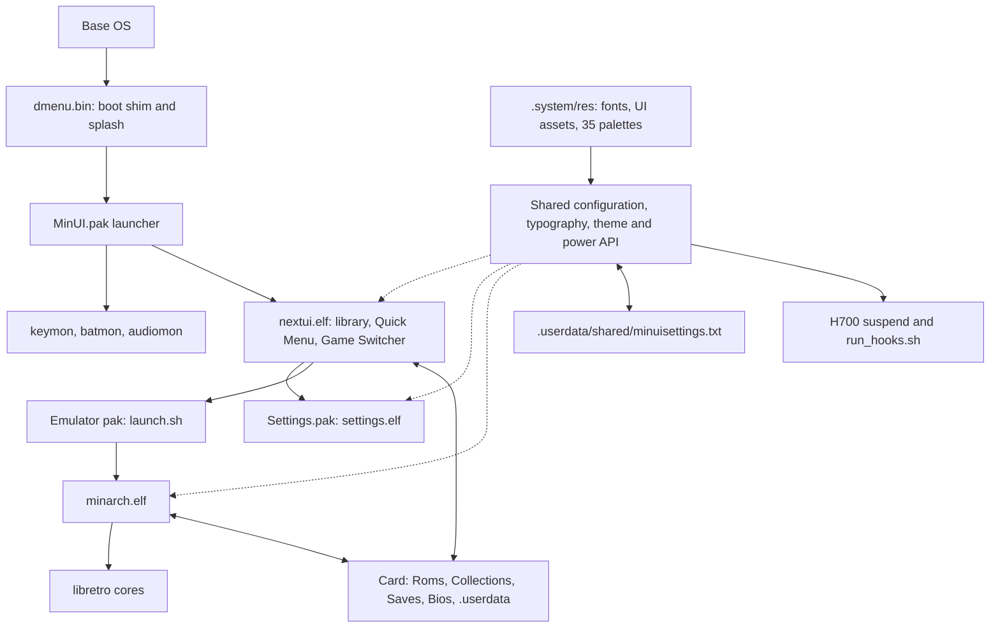

# Architecture

Nocturne is a NextUI-derived frontend distribution for the Anbernic RG40XX H. It keeps the upstream runtime model and pak format, and changes the visual system, typography, motion, and H700 defaults.

## Lineage

| Project | Role |
| --- | --- |
| [MinUI](https://github.com/shauninman/MinUI) | Original minimal handheld frontend by Shaun Inman |
| [NextUI](https://github.com/LoveRetro/NextUI) | Community fork of MinUI with paks, settings, cores, and broader device support |
| Nocturne | H700-focused fork of NextUI maintained by Nadim Hider |

Nocturne preserves upstream compatibility identifiers, card paths, pak conventions, and license notices. It is an independent project and is not published, endorsed, or supported by the NextUI team or the original MinUI author. See [NOTICE](../NOTICE).

## Runtime components



The boot shim runs within the existing Base OS installation. A component update
does not replace that OS, its kernel, the installed emulator cores, or user data.

| Component | Responsibility |
| --- | --- |
| `dmenu.bin` | Boot shim, payload extraction, card mount, install and update handoff, and the Departure Mono boot splash |
| `keymon.elf` | Handles H700 volume keys and Menu + volume brightness adjustment |
| `nextui.elf` | Game-system list, navigation, palettes, typography, motion, Quick Menu, and Game Switcher |
| `minarch.elf` | Loads libretro cores, manages save states, shaders, cheats, remaps, and in-game shortcuts |
| `Settings.pak` | Appearance, display, system, in-game, network, Bluetooth, and device settings |
| `LedControl.pak` | RGB LED configuration |
| `CleanRomset.pak` | Consolidates legacy ROM folders and removes non-ROM files |
| `syncsettings.elf`, `nextval.elf` | Supporting utilities for settings synchronization and value editing |
| `suspend`, `run_hooks.sh` | H700 suspend/resume coordination, state restoration, and lifecycle hooks |

## Repository layout

```text
workspace/
  all/
    common/      Shared UI, theme, configuration, video, input, HTTP, and utilities
    nextui/      Frontend
    minarch/     Libretro launcher
    settings/    Settings application
    ledcontrol/  LED control application
    clock/       Clock application
  h700/          H700 platform layer, key monitor, packaging, and device support
skeleton/
  BASE/          Card skeleton and base assets
  SYSTEM/        .system resources, fonts, palettes, and platform files
  EXTRAS/        Optional emulator paks and tools
docs/            Installation, controls, configuration, architecture, validation
.github/         CI and H700 packaging workflows
```

The shared layer under `workspace/all/common` contains the palette engine,
`theme.h` contrast rules, `typography.h` font scale, SDL_ttf font loading, row
metrics, text fitting, animation helpers, configuration parser, and power API.
H700 hardware integration lives under `workspace/h700`; installed platform
scripts and assets come from `skeleton/SYSTEM/h700`.

## Boot and runtime flow

1. Base OS starts the H700 boot shim from the boot partition. The shim extracts its payload, draws the Nocturne wordmark in Departure Mono, mounts the card, and starts the launcher.
2. The launcher starts the H700 helper processes, including `keymon.elf`, `batmon.elf`, and `audiomon.elf`, then starts `nextui.elf` from `.system/h700/bin`.
3. The frontend loads `.userdata/shared/minuisettings.txt`, applies the saved palette and font, and opens the configured startup view.
4. The frontend scans the card for game-system folders and reads the selected directory.
5. Launching a game starts `minarch.elf` with the matching pak and libretro core.
6. Exiting a game returns to the frontend and updates the recent list.

Nocturne defaults `defaultView` to the game-system list. The frontend clamps persisted values to a valid view when it starts, so an invalid or outdated setting cannot leave the device on an empty screen.

## Theme and typography

The palette engine exposes seven semantic slots:

| Slot | Role |
| --- | --- |
| `color1` | Selection fill |
| `color2` | Header and footer surface |
| `color3` | Raised surface |
| `color4` | Primary text |
| `color5` | Text on the selection |
| `color6` | Secondary text and hints |
| `color7` | Backdrop |

Selection text is derived from the selection fill. Imported palettes are normalized
for dark opaque surfaces and lifted text contrast; the original palette file is
not rewritten. The 35 shipped palettes include 10 Night options with darker
surfaces and softer text and accents. User palettes can live in `/Palettes` at the
card root. See the [palette guide](PALETTES.md).

Fonts are loaded from `.system/res` through SDL_ttf. Departure Mono is the default;
Silkscreen, Home Video, and Fake Receipt are also shipped. Primary font handles
(`large`, `medium`, and `small`) deliberately share one size across library,
Settings, and in-game menus. The names remain for compatibility with callers.

| Preset | Primary text | Secondary text | Battery micro text |
| --- | --- | --- | --- |
| Compact | 9 pt | 8 pt | 8 pt |
| Comfortable, default | 10 pt | 8 pt | 8 pt |
| Large | 12 pt | 10 pt | 8 pt |
| Extra Large | 14 pt | 12 pt | 9 pt |

These are logical sizes before H700's 2× scaling. The default primary size matches
the Settings app's original comfortable body text. Option row heights use loaded
font metrics and padding; label and value columns fit text within their allocated
widths. Live font changes retain the working handles if a replacement fails to
load. Missing selected fonts fall back to Departure Mono.

## Sleep and recovery

The shared power API keeps two stages: screen-off first, then deep suspend after
the configured delay. A disabled suspend timeout leaves the device screen-off
while yielding CPU time. Existing charging and USB exceptions remain in effect.

On H700, the caller closes audio and pauses helper processes before the platform
suspend script runs. The script snapshots mixer state, stops active radios, and
requests kernel suspend. Wake restores the display/LED and mixer state before
returning; the caller then resumes helpers and reopens audio. Radio reconnection
continues asynchronously so it does not hold up input handling.

Failed suspend restores the awake state instead of escalating to power-off.
A second attempt is cancelled while a prior radio-restore worker is busy, and
sleep/resume hooks are bounded. The helper restores state on normal return,
failure, and catchable termination. See [sleep and wake](SLEEP.md) for details and
the remaining hardware validation checklist.

## Motion

Selection glide and screen transitions are time-based. The selection worker runs eight eased frames at 60 fps and measures each frame from the start of the callback, sleeping only the remaining part of the 16.67 ms budget. This keeps motion consistent when presenting a frame takes longer than expected.

Screen transitions use elapsed wall-clock time and 60 fps frame pacing. Snappy transitions run for 100 ms, comfortable transitions for 160 ms. The animation setting also controls title scrolling.

## Build pipeline

| Workflow | Runner | Output |
| --- | --- | --- |
| `h700.yaml` | `ubuntu-24.04-arm` | Cross-builds the H700 components, packages `h700-update`, and uploads the `h700-boot` payload |
| `ci.yaml` | `ubuntu-24.04-arm` | Builds the full core matrix and aggregate release package |
| `dev.yaml` | Hosted runner | Desktop and development builds |
| `ui-validation.yaml` | `ubuntu-24.04` | Host policy, palette, typography and mocked sleep checks; desktop app builds and font-size screenshots |

Local H700 builds use the `ghcr.io/loveretro/h700-toolchain:latest` container:

```sh
make setup
make build PLATFORM=h700 COMPILE_CORES=false
```

Host policy tests run without the cross toolchain:

```sh
make test-nocturne
```

The H700 packaging step collects the frontend, MinArch, key monitor, supporting
utilities, Settings, LED Control, and CleanRomset into an update archive. It also
ships `suspend`, `run_hooks.sh`, and the complete shared `.system/res` resources,
including the four fonts and all 35 palettes. The boot payload is uploaded as a
separate artifact. Release packaging combines the verified components and boot
payload under their card paths and writes `.system/version.txt` with the release
and build stamp.

## Compatibility

Nocturne preserves the following NextUI interfaces:

- Pak folders with a `launch.sh` entry point
- `.system/h700/bin`, `.system/h700/paks`, and `.system/h700/cores` paths
- `.userdata` configuration, save, state, and log paths
- `minuisettings.txt` key names and value formats
- Save and state format settings
- Emulator pak tags and ROM folder naming
- PolyForm Noncommercial 1.0.0 licensing and upstream notices

Changes that would break these interfaces are out of scope for a point release.

## Design constraints

- Panel: 640 x 480, 4:3, 4-inch class display.
- Target frame rate: 60 fps for frontend motion.
- Storage: exFAT SD card with root-level system directories.
- Runtime: frontend, key monitor, battery monitor, audio monitor, and the launched game.
- Memory: preview caching is bounded to three entries.
- Input: H700 buttons, volume keys, power, and optional USB or Bluetooth controllers.

## Release process

1. Build the H700 components from the target commit through `h700.yaml`.
2. Run the full CI matrix through `ci.yaml`.
3. Verify the installed binaries are aarch64 and retain their shared-library dependencies.
4. Verify the boot payload is LF-only, extracts cleanly, and contains the expected splash strings.
5. Check the card layout, palettes, settings, fonts, and boot-critical files.
6. Flush the card and run a file system check before ejecting.
7. Boot the device and complete the validation checklist.
8. Publish the release asset with the build commit, workflow runs, and SHA256.

The current validation record is in [VALIDATION.md](VALIDATION.md).
